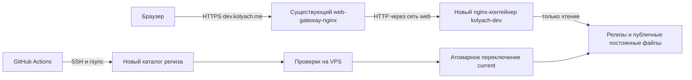

# Предложение по интеграции dev.kolyach.me в VPS

Статус: предложение по результатам обследования 15 ноября 2026 года. Изменений на VPS не выполнялось: конфигурация, контейнеры, сертификаты, пользователи и права оставлены в прежнем состоянии. Проверка `nginx -t` выполнена без reload.

## Что обнаружено

| Область           | Наблюдение                                                                                                                                                                                                                    |
| ----------------- | ----------------------------------------------------------------------------------------------------------------------------------------------------------------------------------------------------------------------------- |
| ОС и ресурсы      | Ubuntu 24.04 LTS, около 2 ГиБ RAM, 2 ГиБ swap. На корневом диске свободно около 6,2 ГиБ из 29 ГиБ. Это снимок на время обследования.                                                                                          |
| Входящий трафик   | Порты 80/443 опубликованы контейнером `web-gateway-nginx`, образ `nginx:1.29-alpine`. Отдельного запущенного nginx-сервиса хоста нет.                                                                                         |
| Gateway           | Compose-проект `/opt/web-gateway`, конфиги отдельных доменов в `nginx/conf.d`. Проверка действующей конфигурации успешна.                                                                                                     |
| Сеть              | Gateway и публичные frontend-контейнеры подключены к внешней Docker-сети `web`. Backend и PostgreSQL существующего приложения находятся в отдельных сетях.                                                                    |
| TLS               | Certbot запускается как maintenance-сервис того же Compose-проекта. Challenge размещается в общем webroot. Сертификаты доступны gateway только для чтения.                                                                    |
| Продление TLS     | Ежедневный cron запускает `certbot-renew.sh`: renew, затем `nginx -t` и reload. Часовой пояс VPS — UTC. Новый сертификат следует включить в эту схему.                                                                        |
| Новый домен       | С VPS `dev.kolyach.me` разрешается в IPv4 этого сервера; IPv6-адрес через системный resolver не получен. Маршрута и отдельного сертификата для домена нет. HTTP закрывается default-сервером, HTTPS отклоняется на этапе TLS. |
| Инструменты       | Docker Compose, rsync, git и Python 3.12 доступны. Node.js не найден в PATH и проверенных стандартных расположениях; текущие серверные JS-скрипты проекта пока запускать нечем.                                               |
| Администрирование | Текущий SSH-пользователь имеет доступ к Docker и группе `web`; sudo без пароля недоступен. Для CI нужен отдельный пользователь с более узкими правами.                                                                        |

Проверки из VPS получили HTTPS 200 от `kolyach.me`, `wedding.kolyach.me` и `kamoved.ru`. `2popuga.kolyach.me` уже возвращает HTTPS 502: маршрут указывает на `2popuga-bot:3000`, но среди запущенных контейнеров такого upstream нет. Это исходное состояние, не последствие интеграции; причину отдельно не исследовали.

## Рекомендуемая схема



Добавить отдельный небольшой Compose-проект `/opt/kolyach-dev` с nginx-контейнером и уникальным сетевым alias `kolyach-dev`. Подключить его к существующей сети `web`, без публикации портов на хосте. HTTPS и ACME остаются на gateway, внутренний nginx слушает HTTP.

Gateway получает один новый файл `/opt/web-gateway/nginx/conf.d/dev.kolyach.me.conf`. Проксирование повторяет существующий приём: Docker DNS `127.0.0.11`, переменная upstream и `proxy_pass`, чтобы смена IP контейнера не требовала reload gateway. HTTP-конфигурация сохраняет доступ к `/.well-known/acme-challenge/`, остальные запросы после настройки TLS перенаправляет на HTTPS.

Это соответствует действующему runbook `/opt/web-gateway/README.md`. Общая внешняя сеть поддерживается [Docker Compose](https://docs.docker.com/compose/how-tos/networking/). Перечитывание nginx позволяет применить конфигурацию с завершением текущих запросов старыми worker-процессами: [управление nginx](https://nginx.org/en/docs/control.html).

### Данные и переключение релизов

Сохранить принятый в проекте корень `/srv/kolyach-dev`:

```text
/srv/kolyach-dev/
  releases/<release-id>/        # Только проверенный out/ из CI
  live/current -> ../releases/<id> # Атомарное переключение после preflight
  shared/runtime-config.json   # Публичные контакты и resumeUrl
  shared/resume.pdf            # Только при локальном варианте резюме
  assets/_next/static/         # Хешированные ресурсы сохраняемых релизов
  tools/                       # Серверные скрипты; вне публичной раздачи
```

В контейнер монтировать только каталоги `releases`, `live`, `shared` и `assets`, каждый по тому же абсолютному пути, что на хосте. Корень внутреннего nginx — `/srv/kolyach-dev/live/current`. Это небольшое изменение текущего активатора: указатель переносится в отдельный каталог `live`, который можно смонтировать целиком. Секретный env и tools не попадают в mount или публичную раздачу. Все публичные bind mounts — только для чтения.

Важно монтировать родительский каталог указателя, а не сам `current`: Docker разрешает путь bind mount при создании контейнера, и переключение symlink на хосте не должно оставлять контейнер привязанным к старому релизу. Абсолютные symlink должны разрешаться по тем же путям внутри контейнера. Аналогично JSON и PDF заменяются атомарно внутри смонтированного каталога, а не через отдельные bind mounts файлов. Основание: [модель bind mounts Docker](https://docs.docker.com/engine/storage/bind-mounts/).

Сохранить независимые контакты и PDF, `no-store` для них, повторную проверку HTML и длительное кеширование хешированных ресурсов. Обычный релиз меняет файлы и указатель; перезапуск контейнера и reload gateway не нужны.

Дополнить существующий механизм сохранением хешированных ресурсов старых релизов: наличия старого каталога недостаточно, если nginx ищет всё только через `current`. Иначе уже открытая страница может запросить старый JS после переключения и получить 404. Предлагается общий каталог хешированных ресурсов с добавлением новых файлов до активации, без перезаписи существующего файла другим содержимым. Очистка выполняется отдельно с учётом сохраняемых релизов и кеширования.

### Среда серверных скриптов

Для первого релиза предлагается сохранить `generate-runtime.mjs`, `activate-release.mjs` и общий валидатор TypeScript. Однократно установить поддерживаемую Node.js 24 в отдельный каталог под управлением администратора, например `/opt/node24`, и использовать абсолютный путь к `node` в инструкциях и workflow. Зависимости npm и сборка на VPS не нужны, постоянно работающего процесса Node.js не будет.

Это требует установки одной среды, зато сохраняет уже реализованную валидацию без второго варианта на Python или shell. Использование краткоживущего Node-контейнера возможно, но потребует отдельного ограниченного административного wrapper; выдавать CI доступ к Docker ради активации релиза не предлагается.

## Доставка и права

- Создать отдельного SSH-пользователя доставки для этого сайта, без sudo, групп `docker` и `web`, без записи в gateway, TLS и соседние проекты.
- Разрешить запись в каталог новых релизов, хешированных ресурсов и указатель текущего релиза. Tools и runtime должны управляться администратором; публичные контакты и PDF — автором отдельно от CI. Env с исходными значениями хранить вне публичного дерева с правами 600.
- Использовать отдельный ключ CI, не личный ключ из PuTTY. Сохранить проверку host key; приватные ключи, env и реальные контакты не добавлять в репозиторий или артефакты.
- Сохранить правило публикации после merge PR в `production` из `develop`, `release/*` или `hotfix/*`, с повторной проверкой итогового коммита и доставкой именно его артефакта.
- Помимо очереди GitHub Actions добавить серверную блокировку активации и отката. Активатор должен отклонять релиз, если уже опубликован более новый запуск; порядок запуска workflow сам по себе не гарантирует порядок деплоя.
- До переключения проверять HTML, портрет, ссылки на ресурсы сборки, runtime JSON и выбранный PDF, а также чтение из контейнера с его фактическими правами. После переключения проверять HTTPS-страницу и ресурсы; при ошибке возвращать предыдущий указатель и отмечать деплой неуспешным.
- Для первого запуска без предыдущего релиза подготовить возврат к состоянию без публикации нового virtual host. Не затрагивать соседние конфиги.
- С учётом свободных 6,2 ГиБ собирать только в CI. Начать с хранения последних пяти успешных релизов; чистить только каталоги этого сайта, не выполнять общий Docker prune.

## Последовательность первого запуска

1. Подготовить и локально проверить Compose, внутреннюю nginx-конфигурацию, конфигурацию gateway, права и обновлённую активацию. Включить отдельный тест переключения symlink при работающем контейнере, обновления JSON/PDF и доступности JS предыдущего релиза.
2. Администратором создать каталог проекта, пользователя доставки и среду Node.js 24. Установить проверенные tools. Автор задаёт контакты и выбранное резюме вне git.
3. Передать первую проверенную сборку, выполнить preflight и запустить только новый nginx-контейнер. Проверить его из существующей Docker-сети до публичной маршрутизации.
4. Сохранить резервную копию конфигов gateway вне `conf.d`, добавить только HTTP-конфиг нового домена с ACME webroot. Выполнить `nginx -t`, затем reload работающего gateway, без его пересоздания.
5. Выпустить отдельный сертификат через существующий Certbot с `certonly --webroot` для `dev.kolyach.me`. Этот способ не требует остановки веб-сервера: [Certbot webroot](https://eff-certbot.readthedocs.io/en/stable/using.html#webroot).
6. Добавить HTTPS-блок нового домена, снова проверить nginx и выполнить reload. Проверить участие нового сертификата в текущем механизме продления.
7. Проверить снаружи HTTPS, редирект, ресурсы, контакты, резюме, мобильный интерфейс. Сверить соседние домены с исходным состоянием; существующий 502 у `2popuga.kolyach.me` учитывать отдельно.
8. Настроить GitHub Environment, ключ CI и защиту `production` с обязательными checks. Провести следующий релиз через разрешённый PR и проверить откат с сохранением PDF и конфигурации.

## Что изменить в текущем проекте перед запуском

| Файл или область                | Необходимое изменение                                                                                                                                                                                          |
| ------------------------------- | -------------------------------------------------------------------------------------------------------------------------------------------------------------------------------------------------------------- |
| `deploy/nginx.conf`             | Разделить конфиг внутреннего HTTP nginx и TLS/ACME-конфиг существующего gateway. Текущий файл предполагает самостоятельный nginx с портами 80/443 и не соответствует VPS.                                      |
| `deploy/compose.yaml`           | Добавить отдельный frontend-сервис, сеть `web`, alias, mounts и restart policy. Зафиксировать проверенный образ по digest при реализации.                                                                      |
| `scripts/activate-release.mjs`  | Перенести указатель в `live/current`, добавить блокировку, защиту от устаревшего запуска, проверку ресурсов, сохранение старых хешированных assets и механизм отката по результатам проверки после публикации. |
| `.github/workflows/site.yml`    | Указать абсолютный путь Node.js на VPS, использовать обновлённую активацию и проверку опубликованной версии. Сохранить обязательный verify и текущие правила веток.                                            |
| `docs/deployment.md` и OpenSpec | Зафиксировать Docker-gateway, разделение TLS и статической раздачи, реальные роли и пути, подготовку Node.js и проверки отката. Сейчас это предложение, действующий дизайн ещё не пересмотрен.                 |

## Что остаётся неподтверждённым

Не выполнялись выпуск сертификата, renewal dry-run, установка Node.js, изменение nginx, запуск нового контейнера и реальный деплой. Не проверялись настройки firewall, внешняя доступность из независимой сети, DNS у всех резолверов, секреты и защита веток GitHub. Из предыдущей попытки известно об ошибке авторизации GitHub CLI; её исправление требует отдельной проверки. Данные контактов и выбранное публичное резюме во время обследования не читались.

Перед реализацией нужно согласовать эту схему и получить возможность выполнить административные шаги. Текущий доступ уже достаточен для обследования; отсутствие passwordless sudo не означает отсутствия у пользователя административных возможностей вообще.
